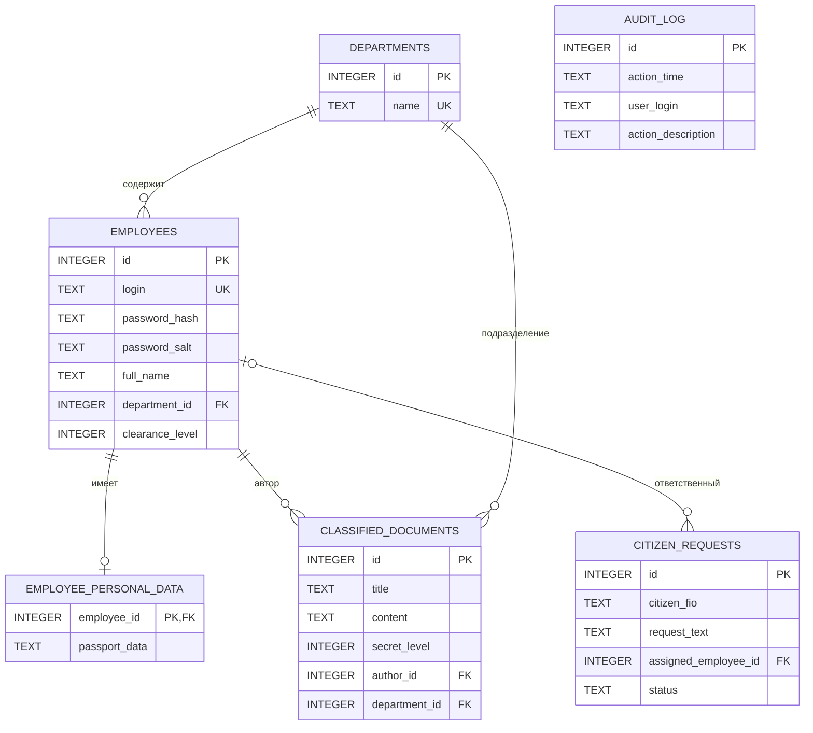

# АИС ведомственного контроля и документооборота

**Лабораторная работа:** «Проектирование схемы базы данных с использованием CASE-средств и аудит безопасности прикладных АИС»

**Автор:** Кабанова Виктория

---

## 1. Описание проекта

Проект представляет собой учебную автоматизированную информационную систему ведомственного контроля и документооборота.

Система предназначена для:
- хранения информации о сотрудниках и подразделениях;
- управления документами с ограниченным доступом;
- регистрации обращений граждан;
- разграничения доступа к информации;
- регистрации действий пользователей.

**Цель проекта** — спроектировать реляционную базу данных, реализовать основные функции информационной системы и провести аудит её безопасности.

### Задачи проекта

1. Разработать структуру реляционной базы данных.
2. Определить сущности, атрибуты и связи между таблицами.
3. Обеспечить целостность и согласованность данных.
4. Реализовать аутентификацию пользователей.
5. Предусмотреть защиту от SQL-инъекций.
6. Реализовать разграничение доступа к документам.
7. Организовать регистрацию действий пользователей.
8. Провести аудит безопасности и определить оставшиеся риски.

## 2. Используемые технологии

| Технология | Назначение |
|---|---|
| C# | Язык программирования |
| .NET 10 | Платформа разработки |
| SQLite | Система управления базами данных |
| Microsoft.Data.Sqlite | Подключение и взаимодействие с БД |
| Mermaid | Построение ER-диаграммы |

## 3. Структура проекта

```text
AIS-Security-Audit/
│
├── MSL/
│   ├── Data/
│   │   ├── DatabaseContext.cs
│   │   ├── DatabaseInitializer.cs
│   │   └── PasswordHasher.cs
│   │
│   ├── Demos/
│   │   ├── AuthenticationDemo.cs
│   │   ├── CitizenServiceDemo.cs
│   │   └── DocumentSearchDemo.cs
│   │
│   ├── Models/
│   │   ├── CitizenRequest.cs
│   │   ├── ClassifiedDocument.cs
│   │   ├── Department.cs
│   │   ├── Employee.cs
│   │   ├── EmployeePersonalData.cs
│   │   └── SecurityLevel.cs
│   │
│   ├── MSL.csproj
│   ├── Program.cs
│   └── UserSession.cs
│
├── MSL.slnx
└── README.md
```

## 4. Проектирование базы данных

База данных состоит из шести таблиц:

| № | Таблица | Назначение |
|---|---|---|
| 1 | Departments | Подразделения организации |
| 2 | Employees | Сотрудники и их учётные записи |
| 3 | EmployeePersonalData | Персональные данные сотрудников |
| 4 | ClassifiedDocuments | Документы ограниченного доступа |
| 5 | CitizenRequests | Обращения граждан |
| 6 | AuditLog | Журнал действий пользователей |

### 4.1. Таблица Departments

Хранит информацию о подразделениях организации.

| Поле | Тип | Описание |
|---|---|---|
| id | INTEGER | Первичный ключ |
| name | TEXT | Название подразделения, уникальное и обязательное |

### 4.2. Таблица Employees

Содержит информацию о сотрудниках и их учётных записях.

| Поле | Тип | Описание |
|---|---|---|
| id | INTEGER | Первичный ключ |
| login | TEXT | Уникальный логин |
| password_hash | TEXT | Хеш пароля |
| password_salt | TEXT | Соль пароля |
| full_name | TEXT | ФИО сотрудника |
| department_id | INTEGER | Внешний ключ на Departments |
| clearance_level | INTEGER | Уровень допуска |

Для поля `clearance_level` предусмотрены значения от 1 до 3.

### 4.3. Таблица EmployeePersonalData

Предназначена для хранения персональных данных сотрудников.

| Поле | Тип | Описание |
|---|---|---|
| employee_id | INTEGER | Первичный и внешний ключ |
| passport_data | TEXT | Паспортные данные |

Таблица отделяет конфиденциальные сведения от основной информации о сотрудниках.

### 4.4. Таблица ClassifiedDocuments

Хранит документы с различными уровнями секретности.

| Поле | Тип | Описание |
|---|---|---|
| id | INTEGER | Первичный ключ |
| title | TEXT | Название документа |
| content | TEXT | Содержание документа |
| secret_level | INTEGER | Уровень секретности |
| author_id | INTEGER | Внешний ключ на Employees |
| department_id | INTEGER | Внешний ключ на Departments |

### 4.5. Таблица CitizenRequests

Предназначена для регистрации и обработки обращений граждан.

| Поле | Тип | Описание |
|---|---|---|
| id | INTEGER | Первичный ключ |
| citizen_fio | TEXT | ФИО заявителя |
| request_text | TEXT | Содержание обращения |
| assigned_employee_id | INTEGER | Внешний ключ на Employees, допускается NULL |
| status | TEXT | Статус обращения |

Допустимые статусы:
- Новое;
- В работе;
- В обработке;
- Завершено;
- Отклонено.

### 4.6. Таблица AuditLog

Используется для регистрации действий пользователей.

| Поле | Тип | Описание |
|---|---|---|
| id | INTEGER | Первичный ключ |
| action_time | TEXT | Дата и время действия |
| user_login | TEXT | Логин пользователя |
| action_description | TEXT | Описание действия |

В текущей реализации `user_login` хранится как текстовое значение. Внешний ключ на таблицу `Employees` отсутствует.

## 5. ER-диаграмма базы данных

Ниже представлена ER-диаграмма, отражающая структуру базы данных и связи между её сущностями.



### 5.1. Описание связей

- **Departments — Employees:** одно подразделение может включать несколько сотрудников.
- **Employees — EmployeePersonalData:** у одного сотрудника может быть не более одной записи персональных данных.
- **Employees — ClassifiedDocuments:** один сотрудник может быть автором нескольких документов.
- **Departments — ClassifiedDocuments:** одно подразделение может быть связано с несколькими документами.
- **Employees — CitizenRequests:** один сотрудник может отвечать за несколько обращений. Обращение при этом может не иметь назначенного сотрудника.
- **AuditLog:** отдельная таблица без внешнего ключа на Employees.

**Примечание о CASE-средствах:** диаграмма представлена в формате Mermaid и отображается непосредственно на GitHub. Если преподаватель требует использования конкретной CASE-программы, например ERwin или MySQL Workbench, диаграмму необходимо дополнительно создать или импортировать в эту среду. Само наличие Mermaid-диаграммы не подтверждает работу в конкретной CASE-программе.

## 6. Реализация приложения

Приложение реализовано на C# с использованием .NET 10 и SQLite.

Основные возможности:

1. Аутентификация пользователей.
2. Поиск документов с учётом уровня допуска.
3. Регистрация обращений граждан.
4. Получение SQL-описания структуры базы данных.

Создание таблиц и заполнение демонстрационными данными выполняется при инициализации базы данных.

### 6.1. Уровни допуска

| Значение | Уровень |
|---|---|
| 1 | Официальный |
| 2 | Секретный |
| 3 | Совершенно секретный |

Уровень допуска сотрудника хранится в базе данных. При поиске документов приложение использует уровень допуска текущего пользователя из `UserSession`.

## 7. Аудит безопасности

В ходе анализа были рассмотрены основные риски, связанные с хранением данных, аутентификацией, SQL-запросами, разграничением доступа и целостностью базы данных.

| Проблема | Возможные последствия | Реализованная мера |
|---|---|---|
| Хранение паролей в открытом виде | Компрометация учётных записей | PBKDF2, случайная соль и хеширование |
| SQL-инъекция при авторизации | Обход аутентификации | Параметризованные запросы |
| SQL-инъекция при поиске | Несанкционированное получение данных | Параметризация поисковых запросов |
| Подмена уровня допуска | Просмотр закрытых документов | Уровень допуска берётся из текущей сессии |
| Отсутствие внешних ключей | Появление несвязанных записей | Внешние ключи и `PRAGMA foreign_keys = ON` |
| Недопустимые уровни секретности | Нарушение правил классификации | Ограничения `CHECK` |
| Недопустимые статусы обращений | Некорректное состояние заявок | Ограничение `CHECK` |
| Отсутствие транзакций | Частичное сохранение данных | Использование транзакций |
| Раскрытие технических ошибок | Утечка внутренней информации | Обобщённые сообщения об ошибках |

### 7.1. Безопасное хранение паролей

Пароли не сохраняются в базе данных в открытом виде.

Для каждого пароля создаётся случайная соль, после чего вычисляется хеш с использованием PBKDF2 и SHA-256.

Используемые параметры:
- алгоритм: PBKDF2;
- хеш-функция: SHA-256;
- размер соли: 16 байт;
- размер хеша: 32 байта;
- количество итераций: 100 000.

В базе данных сохраняются только хеш пароля и соль.

### 7.2. Защита от SQL-инъекций

Пользовательские данные передаются в SQL-запросы через параметры, а не объединяются напрямую со строкой SQL.

Это снижает риск выполнения посторонних SQL-команд через поля ввода.

### 7.3. Разграничение доступа

Каждый сотрудник имеет определённый уровень допуска. При поиске документов приложение проверяет уровень допуска текущего пользователя.

Дополнительно в базе данных используются ограничения `CHECK`, запрещающие сохранение недопустимых значений уровней доступа.

### 7.4. Транзакции и аудит

При регистрации обращения используется транзакция. Запись обращения и запись о действии пользователя сохраняются совместно.

Если операция завершается ошибкой, изменения отменяются. В журнал записывается логин текущего пользователя и описание выполненного действия.

## 8. Выявленные ограничения и рекомендации

Текущая версия является учебной и не предназначена для непосредственного использования в реальной ведомственной системе.

В ходе аудита выявлены следующие ограничения:

1. **Паспортные данные не зашифрованы.** Они вынесены в отдельную таблицу, однако для реальной эксплуатации необходимо дополнительно реализовать шифрование конфиденциальных полей и безопасное хранение ключей.
2. **Упрощённая модель сессии.** `UserSession` хранит текущего пользователя в статическом свойстве. Для многопользовательской системы требуется полноценное управление сессиями.
3. **Журнал аудита не связан внешним ключом с сотрудниками.** Для улучшения целостности можно добавить `user_id` с внешним ключом.
4. **Используются демонстрационные пароли.** Их необходимо заменить перед любым реальным использованием.
5. **Не реализовано полноценное управление ролями.** Для промышленной системы требуется детальная матрица прав доступа.
6. **SQLite используется как учебное хранилище.** Для многопользовательской эксплуатации необходимо дополнительно оценить требования к резервному копированию, восстановлению и конкурентному доступу.

## 9. Запуск проекта

Для запуска требуется установленный .NET SDK версии 10.

Из корневой папки проекта выполните команды:

```bash
dotnet restore
dotnet build
dotnet run --project MSL/MSL.csproj
```

При первом запуске приложение создаёт базу данных и добавляет демонстрационные записи, если сотрудники ещё не созданы.

### 9.1. Тестовые учётные записи

| Логин | Пароль | Уровень допуска |
|---|---|---|
| minister | `SuperMinister2026!` | 3 |
| analyst_petrov | `petrovPass` | 2 |
| clerk_sidorov | `123456` | 1 |

**Важно:** учётные записи предназначены только для демонстрации работы учебного приложения. Не используйте эти пароли в реальных системах.

## 10. Вывод

В ходе лабораторной работы была разработана структура реляционной базы данных для автоматизированной информационной системы ведомственного контроля и документооборота.

Были определены основные сущности, атрибуты, первичные и внешние ключи, ограничения целостности и связи между таблицами.

Реализованы основные функции приложения: аутентификация пользователей, поиск документов с учётом уровня допуска и регистрация обращений граждан.

В рамках аудита безопасности рассмотрены риски хранения паролей, SQL-инъекций, нарушения разграничения доступа и целостности данных. Для снижения этих рисков применены хеширование паролей с солью, параметризованные SQL-запросы, внешние ключи, ограничения `CHECK` и транзакции.

Также определены ограничения учебной реализации и направления дальнейшего повышения безопасности системы.
